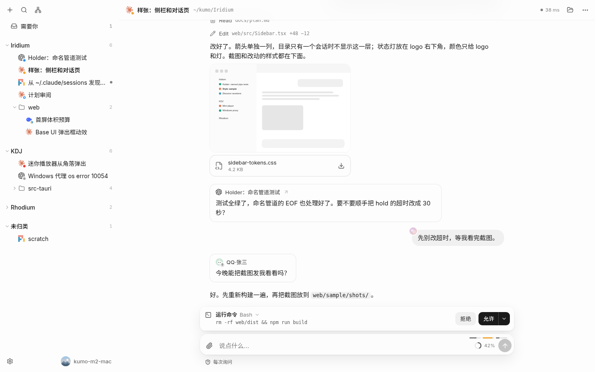

# Iridium

把散落在终端和多台电脑里的 AI Agent 会话收进同一个界面。

Iridium 是一个纯 Go 写成的轻量服务（单个二进制，内嵌网页前端，另配基于 **Mygo** 编写的客户端），原生支持 **Claude Code**、**Codex**、**pi**、**DeepSeek Harness (dsh)** 与 **Antigravity CLI (agy)**。



## 能做什么

- **随时随地接着聊**
  自动发现在终端里已经跑起来或留在磁盘上的会话，按文件夹归组。在别处开着的会话可以实时看进度，退出后直接在这里接管；托管的进程由独立的 `hold` 看管，Iridium 重启或更新都不会打断正在跑的回合。
- **在一个频道里拉多个 Agent 一起干活**
  每个会话本身就是一个频道。随时把不同模型、甚至不同电脑上的 Agent 邀请进同一个频道，用 `@称呼` 点名交办任务，或按接收规则让它们自动接话。支持引用、贴表情、撤回、折叠长消息，以及按关键词、`/命令` 或 `cron` 定时触发的频道脚本；每个文件夹组还带一个低延迟语音房间。
- **角色卡与跨会话记忆**
  给 Agent 设好头像、背景、简介与行为设定（支持直接导入 DSH Desktop / OMD 的人格），存成可复用的**角色**。Agent 可以主动把重要结论写进持久记忆（`remember`），跨会话、跨频道随时检索（`recall`）。
- **把别的电脑接进来**
  其他 Mac、Linux 或 Windows 电脑跑一条 `ir join`（或装上 `dsh-remote-iridium` 插件），核对配对码就能接入。在这边就能直接开那台电脑上的 Agent、读写文件、跑命令（`ir sh`）或同步 DSH Desktop 工作区，各台机器的密钥留在当地。
- **安全的公网访问与凭据注入**
  默认只监听本机 `127.0.0.1:7810`。需要从外面连入时，`ir public` 一键配好 Cloudflare Tunnel 并开启 Passkey 登录，也支持为单个会话生成只读的公开分享链接。密码和 API Key 加密存在凭据库里，Agent 通过 `ir run` 带进命令，输出和聊天记录里自动打码。
- **开放的 Satori 接口**
  网页、客户端、命令行 `ir` 与外部 Bot 共用同一套 **Satori with ir** 协议（HTTP + WebSocket 事件流）。外部应用通过配对接入，按应用和登录分别控制能用哪些 Agent、能看哪些文件夹。

## 安装与启动

### 一键安装

**macOS / Linux**

```sh
curl -fsSL https://github.com/kumoSleeping/Iridium/releases/latest/download/install.sh | sh
```

**Windows (PowerShell)**

```powershell
irm https://github.com/kumoSleeping/Iridium/releases/latest/download/install.ps1 | iex
```

也可以直接去 [Releases](https://github.com/kumoSleeping/Iridium/releases/latest) 下载对应系统的安装包或 `.tar.gz` 压缩包。

### 常用命令

```sh
ir start                              # 注册并启动常驻服务（有桌面时同时打开窗口）
ir start --headless                   # 只跑后台服务（默认监听 http://127.0.0.1:7810）
ir public                             # 开启 Cloudflare Tunnel + Passkey 公网访问（关闭：ir public off）
ir join <地址>                        # 把这台电脑接入另一台 Iridium（断开：ir leave <地址>）
ir start --no-server --join <地址>    # 不起本机服务，只作为另一台 Iridium 的执行端常驻
ir status                             # 查看当前运行与连接状态
ir stop                               # 停止并移除常驻服务
```

更新版本直接在「设置」里点一下即可，默认也会在后台自动下好新版本。

## `ir` 命令行

人在终端里、或者 Agent 在会话里，都用同一个 `ir` 命令和 Iridium 交互。不知道路由名字时，跑 `ir api help` 逐层查：

```sh
ir api help                                                          # 查看常用接口与分话题说明
ir api help channel.create                                           # 查看单个接口的参数说明

ir api channel.list                                                  # 列出文件夹和会话
ir api channel.create _data.agent=claude _data.cwd=. _data.text="…"  # 开新会话派活（加 --wait 等它跑完回话）
ir api message.create channel_id=<id> content="…"                    # 往会话或频道发消息
ir api GET internal/sessions/<id> --wait                             # 等目标会话当前回合结束

ir api POST internal/channels/<频道 ID>/members agent=codex nick=codex    # 邀请另一个 Agent 进这个频道
ir api internal/recall q="关键词"                                    # 搜记忆和历史消息
ir api internal/remember text="…"                                    # 记下一条跨会话记忆
ir api POST internal/links path=/path/to/file                        # 生成发在回复里的文件或图片链接

ir run --secret GITHUB_TOKEN -- gh release list                      # 把凭据注入命令并在输出里打码
```

## 文档

- **概念与设计**：[术语表](GLOSSARY.md) · [设计计划](docs/plan.md) · [前端设计规范](docs/前端设计规范.md)
- **功能细节**：[客户端与桌面窗口](docs/app.md) · [频道、角色与记忆](docs/channels.md) · [接入别的电脑](docs/exec.md) · [语音房间](docs/voice.md)
- **接口与安全**：[内部接口](docs/api.md) · [应用接口 (Satori)](docs/satori.md) · [网页层与 Passkey](docs/web.md) · [TOKEN 门与权限](docs/gate.md) · [旧接口变更](docs/legacy.md)
- **运维**：[部署指南](docs/deploy.md)

## 开发

需要 Go 1.27（纯 Go，无 cgo）与 Node 24。

```sh
(cd web && npm ci && npm run build && npm run build:app)   # 构建前端页面
go test ./... && go vet ./...                              # Go 测试与静态检查
(cd web && npm run check)                                  # 前端类型与测试检查
scripts/deploy.sh                                          # 构建并安装到本机用户服务
```

MIT 许可。
